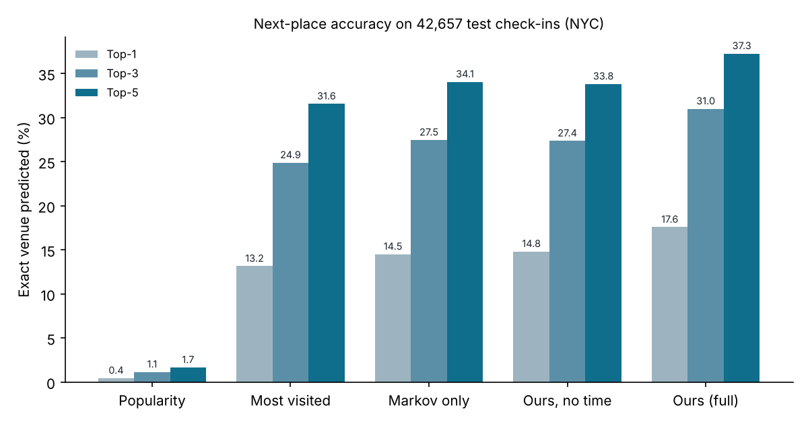

# SyncroMove

Predicts the three places a logged-in user is most likely to visit next, from their own
check-in history, and explains each prediction.

The prediction is a **fixed, explainable rule** (Markov transitions + time of day + frequency +
recency). There is **no training**, no fitted weights and no ML library. It is measured on the
Foursquare New York check-in dataset: **31.0% top-3 accuracy on 42,657 unseen check-ins**, against
24.9% for "the user's most visited places". Details are in [docs/EVALUATION.md](docs/EVALUATION.md).

College AIML Skill Lab: Project 1, Sequence Prediction (Medium).
Design document: [docs/LLD.md](docs/LLD.md).



## What it does

- Register (optionally with a **sample New York history**, because the data is NYC 2012–13), log
  in, log out.
- A **transit-map dashboard**: your last 8 check-ins drawn as a subway line, with the 3 predicted
  next stops branching off as numbered bullets.
- **Next stops** with likelihood, distance and a one-line reason. **Why?** shows the four signal
  values and weights behind each prediction.
- **Check in** by searching places by category (nearest first). Each check-in records whether we
  predicted it (*Predicted #2* / *Missed*).
- **How accurate is this?**: measured top-1/3/5, the baseline comparison, and your own hit rate.
- **Export** all your data as JSON, delete your check-ins, or delete your account.

## Run it on localhost

Needs Python 3.11 or newer. The app runs straight after cloning: the processed venue list and
sample histories are committed, so you don't need the raw dataset.

**PowerShell (Windows)**

```powershell
python -m venv .venv
.\.venv\Scripts\Activate.ps1
pip install -r requirements.txt
python run.py
```

**bash (macOS / Linux / Git Bash)**

```bash
python3 -m venv .venv
source .venv/bin/activate
pip install -r requirements.txt
python run.py
```

Open http://127.0.0.1:5000, create an account and leave **Load a sample New York history** ticked.

`python run.py` uses Flask's development server. `python serve.py` uses waitress, a
production-grade WSGI server, on the same address.

If PowerShell refuses to run `Activate.ps1`, run
`Set-ExecutionPolicy -Scope CurrentUser RemoteSigned` once, or call `.venv\Scripts\python.exe run.py`
directly.

## Re-run the import and the evaluation (optional)

1. Download the **Foursquare NYC and Tokyo check-in dataset** from the original source,
   https://sites.google.com/site/yangdingqi/home/foursquare-dataset, or from Kaggle
   ("FourSquare - NYC and Tokyo Check-ins").
2. Put `dataset_TSMC2014_NYC.txt` (or the Kaggle `.csv`) in `data/raw/`. That folder is git-ignored.
3. Run:

```bash
pip install -r requirements-dev.txt
python scripts/import_dataset.py
python scripts/evaluate.py
python scripts/render_docs.py
```

`import_dataset.py` prints the dataset statistics, checks them against the expected values and
rewrites the two committed data files. `evaluate.py` replays the last 20% of check-ins (about 11 s)
and writes `docs/evaluation_results.json` and `docs/accuracy.png`. `render_docs.py` refills every
figure in `docs/LLD.md` and `docs/EVALUATION.md` from that JSON. Use `--data PATH` if the file is
somewhere else.

## Tests

```bash
pip install -r requirements-dev.txt
python -m pytest
```

33 tests cover the algorithm, including the worked example from the design doc, plus auth,
validation, the API and an evaluation smoke test.

## Configuration

Defaults live in `config.py`. Override any of them with environment variables or a `.env` file
(copy `.env.example`). The algorithm weights are design constants: if you change one, re-run
`scripts/evaluate.py` and report the new numbers.

## Project layout

```
config.py                 settings (weights, paths, limits)
run.py / serve.py         start the app (Flask dev server / waitress)
predictor/                the prediction rule: pure Python, no I/O
scripts/                  import_dataset.py, evaluate.py, render_docs.py
app/                      Flask app: auth, pages, JSON API, repository (all SQL), templates, static
data/                     venues.csv.gz, samples/sample_histories.json.gz (raw/ is git-ignored)
docs/                     LLD.md, EVALUATION.md, evaluation_results.json, accuracy.png, templates/
tests/                    pytest suite
```

## Data and licences

- Dataset: D. Yang, D. Zhang, V. W. Zheng, Z. Yu, "Modeling User Activity Preference by Leveraging
  User Spatial Temporal Characteristics in LBSNs," *IEEE Trans. SMC: Systems*, 45(1), 129–142,
  2015. The raw file is not included in this repository; the committed venue list and sample
  histories are derived from it. Cite the paper if you use them.
- Font: Overpass, SIL Open Font License 1.1 (`app/static/fonts/OFL.txt`).
- Code: MIT (see `LICENSE`).
