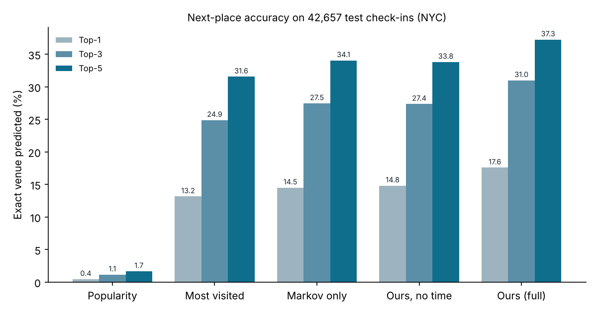

<!-- Generated by scripts/render_docs.py from docs/templates/EVALUATION.md.tmpl and docs/evaluation_results.json. Edit the template, not this file. -->

# SyncroMove: evaluation

All numbers below come from `docs/evaluation_results.json`, written by
`python scripts/evaluate.py` (run 2026-11-25T13:25:19Z, algorithm `rule-v1`, 11.0 s
on a laptop-class CPU). **Nothing is trained or tuned.** The script only replays history and counts.

## Protocol

| Step | What happens |
|---|---|
| Data | `dataset_TSMC2014_NYC.txt`: 227,428 rows → 227,178 after dropping exact duplicates → 215,078 after collapsing back-to-back repeats at the same venue; 1,083 users |
| Test window | The last 20.0% of de-duplicated check-ins by time, from **2012-11-23 21:01:22 UTC** |
| No peeking | City popularity is counted only from check-ins before the window. Each prediction uses only that user's earlier check-ins |
| Query | For every test check-in that has an earlier check-in: build the profile, score with the check-in's real time as the query time, record the rank of the place actually visited (miss if not a candidate) |
| Scored | **42,657** check-ins from 900 users, every one counted |

## Results



| Method | Top-1 | Top-3 | Top-5 | MRR |
|---|---|---|---|---|
| City popularity only | 0.4% | 1.1% | 1.7% | 0.011 |
| Baseline: user's most visited | 13.2% | 24.9% | 31.6% | 0.219 |
| Markov only (order 1, back-off to frequency) | 14.5% | 27.5% | 34.1% | 0.236 |
| SyncroMove, `W_TIME = 0` | 14.8% | 27.4% | 33.8% | 0.238 |
| **SyncroMove (full rule)** | **17.6%** | **31.0%** | **37.3%** | **0.267** |

Extra measures for the full rule:

| Measure | Value |
|---|---|
| Right kind of place: the true category is among the 3 categories with the highest summed score | 47.4% |
| A top-3 place lies within 1 km of the real one | 61.4% |
| Top-3, user had < 50 earlier check-ins (n = 1,016) | 21.5% |
| Top-3, 50–199 earlier check-ins (n = 23,063) | 27.0% |
| Top-3, 200+ earlier check-ins (n = 18,578) | 36.5% |
| Median of per-user top-3 accuracy | 23.9% |
| Test check-ins at a place the user had never visited before (unpredictable by design) | 37.5% |

## Reading the numbers

- **The rule beats the most-visited baseline by 6.1 points top-3** and by
  4.4 points top-1.
- **Knowing the time of day is worth 3.6 points top-3.** Without it, the rule is no better than plain Markov.
- **The hard ceiling is 62.5%.** 37.5% of test check-ins are at a place the
  user had never been before. No method that only ranks the user's own places can get those, so
  even a perfect ranker of known places would top out at 62.5%.
- **More history helps.** Users with 200+ earlier check-ins get 36.5% top-3, against 21.5% for users with fewer than 50.
- **Don't quote 90%.** Predicting the exact venue among 1,083 users' tens of thousands of places is
  hard. If a higher headline is wanted, the category (47.4%) and within-1 km
  (61.4%) figures are real, but they answer easier questions and must be labelled as such.

## Comparison with the spec's reference run (§5.2)

Every top-1/3/5 figure is within ±1 point of the reference; most match to 0.1 point. Known differences:

| Item | Reference | Ours | Cause |
|---|---|---|---|
| Test window start | 2012-11-23 20:58 UTC | 2012-11-23 21:01:22 UTC | We cut at exactly 80% of de-duplicated check-ins (index ⌊0.8·N⌋). The reference's 20:58 isn't any clean 80% index of the raw, de-duplicated or collapsed rows, so its exact rule is unknown |
| Test check-ins | 42,659 | 42,657 | Follows from the cutoff above (2 check-ins) |
| Popularity-only MRR | 0.015 | 0.011 | Not confirmed. Our baseline ranks every venue in the city (the current one excluded). Top-1/3/5 agree within 0.1 point, so the difference is in the long tail of ranks, which MRR weights and top-k ignores |
| Category accuracy | 47.4% | 47.4% | Matches once "top 3 categories" means the 3 categories with the highest summed score. Taking the categories of the top-3 venues instead gives 43.5% |

## Reproduce

```bash
python scripts/import_dataset.py --data data/raw/dataset_TSMC2014_NYC.txt
python scripts/evaluate.py --data data/raw/dataset_TSMC2014_NYC.txt
python scripts/render_docs.py
```

Changing a weight in `config.py` or `.env` is a design change: re-run the three commands and
report the new table. Weights were not chosen by looking at these results.
